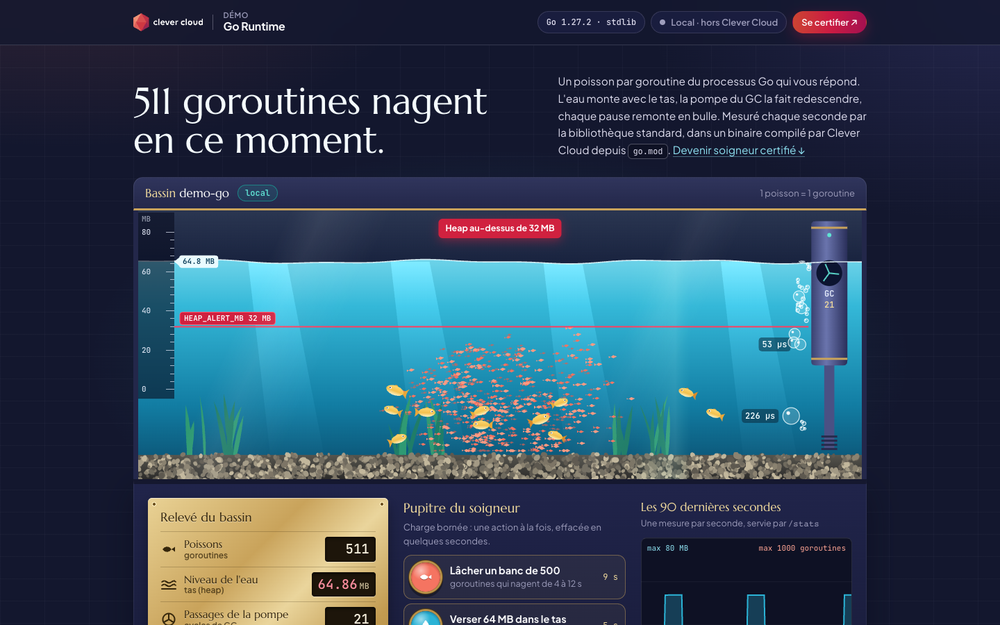
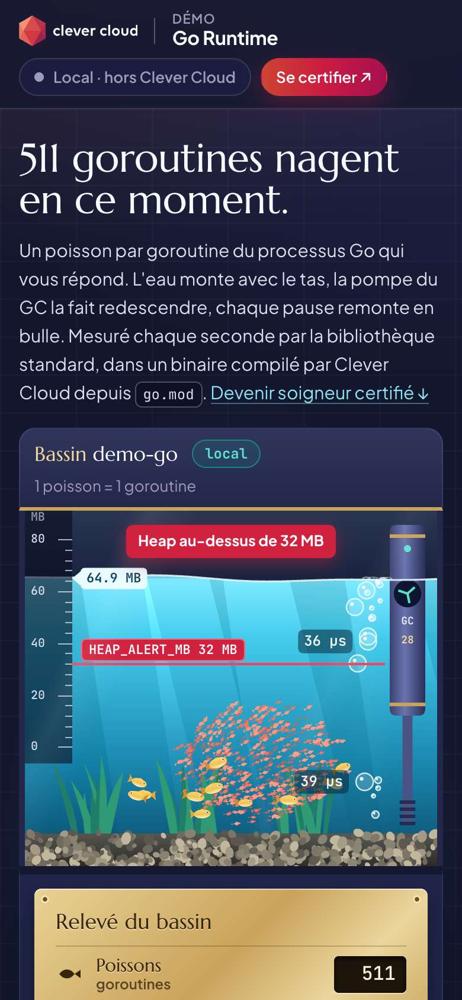

# The Runtime Aquarium — Go on Clever Cloud

> The Go process that answers you, kept as a lit aquarium and measured every second. One fish per goroutine; the water level is the heap, rising toward the red line etched at `HEAP_ALERT_MB`; the GC is the filter pump on the side, and each GC pause rises as a bubble labelled in µs. A brass plate keeps the real figures, a recorder keeps the last 90 seconds, and the keeper's desk has three bounded buttons: release a school of 500 goroutines, pour 64 MB into the heap for 8 seconds, run the GC pump. Standard library only, no add-on: the **Clever Cloud Go runtime** builds the module from `go.mod`, with no Dockerfile, and starts the binary. Framed by the Clever Brand Kit, with the Clever Cloud Academy certification behind a porthole.





**Run it yourself.** The hosted demo was taken down after the presales review (November 2026). The steps in [Deploy on Clever Cloud](#deploy-on-clever-cloud) recreate it from scratch in about 3 minutes.

## What the Go runtime does here

| In the aquarium | Runtime fact | Where it comes from |
|---|---|---|
| A fish | One goroutine, drawn 1 for 1 (up to 2500). Gold fish: the goroutines that are always there (HTTP server, sampler…); coral school: the goroutines of the current burst | `runtime.NumGoroutine`, and the burst counter `b` of each sample |
| The water level | Heap in use, on a ruler in MB stuck on the glass; the ruler fits `HEAP_ALERT_MB` and the 64 MB pour | `MemStats.HeapAlloc` |
| The red etched line | `HEAP_ALERT_MB`; once the water is above it, the line turns solid and *Heap au-dessus de N MB* appears | demo variable |
| The pump and its sweep | A GC cycle: the rotor spins, a sweep crosses the tank, the counter on the pump moves on | `MemStats.NumGC` |
| A bubble | One GC pause, sized and labelled by its duration (µs) | `MemStats.PauseNs` |
| The brass plate and the recorder | Goroutines, heap, GC cycles, last pause, `GOMAXPROCS`, uptime; the last 90 samples, full as soon as the page opens | `GET /stats?history=1`, then one poll per second |
| Build and start | `CC_GO_BUILD_TOOL=gomod`: `go install` of the module, then `$GOPATH/bin/demo-go` on `0.0.0.0:8080`; on SIGTERM (redeploy, scale-down) it finishes in-flight requests, 10 s max | The section *Comment le bassin a été rempli* lists the four real steps; no dependency, so the build downloads nothing |
| The tags | Demo variables and the *Running on Clever Cloud* panel | `APP_ENV` pill on the tank hood, `ANNOUNCEMENT` notice, instance, commit and deployment |

The sampler is one goroutine: `runtime.ReadMemStats` stops the world, so it never runs per request.

| Button on the keeper's desk | Route | Effect | Bound |
|---|---|---|---|
| *Lâcher un banc de 500* | `POST /load/goroutines` | `BURST_GOROUTINES` goroutines, each sleeping 4 to 12 s: a school is released at the surface, then thins out | one burst at a time (max 2000), 429 otherwise |
| *Verser 64 MB dans le tas* | `POST /load/heap` | 64 MB allocated (pages touched), held 8 s, released, then `runtime.GC()`: the water rises, then the pump drains it | one allocation at a time, fixed size |
| *Lancer la pompe GC* | `POST /load/gc` | `runtime.GC()`: the pump runs and a bubble rises | one per 2 s |

Worst case: 2000 sleeping goroutines plus 64 MB. No CPU loop, nothing persistent.

## Deploy on Clever Cloud

You need [clever-tools](https://www.clever.cloud/developers/doc/cli/) (`clever login` done) and the ID of the organisation that will own the resources (`orga_…`, shown in the Console). Run the commands from the repo root: `clever create` links the folder to the new app.

```bash
# 1. The app and its size (no dedicated build instance: the build compiles the standard library only)
clever create --type go demo-go --org <org_id> --region par
clever scale --min-flavor nano --max-flavor XS --min-instances 1 --max-instances 2

# 2. Variables (checked against the Go runtime doc)
clever env set CC_GO_BUILD_TOOL gomod          # build the module from go.mod, no detection
clever env set CC_HEALTH_CHECK_PATH /health    # deployment validated on /health

# 3. Deploy
clever deploy
clever open
```

No add-on, no setup script. Clever Cloud runs `go install` on the module and starts the binary; `clever deploy` is what deploys (a `git push` to another remote does not).

**Why the build is short:** no external dependency (no `go.sum`, nothing to download), and `go.mod` declares `go 1.27`, which is not newer than the Go of the image (1.27.3 since the 2026-10-21 image update). The [Go runtime doc](https://www.clever.cloud/developers/doc/deploy/applications/golang/) warns: *"If the Go version declared in your go.mod file is newer than the one installed on the instance, the Go toolchain downloads the required version automatically"*, an extra download on every build that this setting avoids. `CC_CACHE_DEPENDENCIES` brings nothing here (no module to cache).

`clevercloud/go.json` is a legacy file; the doc says that using it *"is a deprecated method and should no longer be used"*. It is kept until a deployment confirms it can be removed.

## Variables

| Variable | Set by | Role |
|---|---|---|
| `CC_GO_BUILD_TOOL` | you | `gomod`: build the module from `go.mod` |
| `CC_HEALTH_CHECK_PATH` | you | `/health` |
| `APP_ENV` | optional, default `local` | Environment pill on the tank hood (Clever gradient when `production`) |
| `ANNOUNCEMENT` | optional, empty | *Avis aux visiteurs* notice on top of the page when set (160 characters max) |
| `BURST_GOROUTINES` | optional, default `500` (1 to 2000) | Size of the school: button label, number of coral fish, height of the spike on the recorder |
| `HEAP_ALERT_MB` | optional, default `32` (1 to 1024) | Red line etched on the glass and on the recorder; above it the heap figure turns red and *Heap au-dessus de N MB* appears |
| `PORT` | Clever Cloud | Listen port, `8080` when unset |

Invalid or out-of-range values fall back to the default. To show it live: `clever env set HEAP_ALERT_MB 128`, `clever restart`, reload: the ruler goes up to 200 MB and the 64 MB pour stays below the line.

The *Running on Clever Cloud* tag shows, read-only, `CC_APP_NAME`, `APP_ID` (it also switches the *Live on Clever Cloud* pill), `INSTANCE_NUMBER`, `CC_PRETTY_INSTANCE_NAME`, `INSTANCE_TYPE`, `COMMIT_ID`/`CC_COMMIT_ID` (7 characters) and `CC_DEPLOYMENT_ID`/`DEPLOYMENT_ID`; locally each one reads « injecté au déploiement ». The commit variable is set by `clever deploy` and stays set after a `clever restart` (checked on demo-go itself, 2026-11-04); if it is ever empty on Clever Cloud, the tag reads « non renseigné ».

## Routes

`GET /` (page) · `GET /stats` (latest sample `{t, g, b, h, gc, p}`: time, goroutines, burst goroutines still alive, heap MB, GC cycles, last pause µs; plus uptime, page count, burst state; `?history=1` adds the last 90 samples; the page polls it every second) · `GET /health` · `GET /cc-brand.css` · `GET /aquarium.css` · `GET /aquarium.js` · `GET /app.js` · the three `POST /load/*`. Other verbs → 405, other paths → 404. Security headers on every response, 404 and 405 included (strict CSP: no inline script).

## Code tour

```
main.go             HTTP server (timeouts, SIGTERM graceful shutdown), routes, CSP middleware, handlers
pulse.go            runtime sampler (ring of 90 samples) and the bounded load generators
config.go           demo variables (APP_ENV, ANNOUNCEMENT, BURST_GOROUTINES, HEAP_ALERT_MB) and CC_* platform variables
main_test.go        httptest tests (routes, headers, demo variables, bounds, certification block)
static/index.html   page template (html/template), logo and badge SVG
static/aquarium.js  the tank on a <canvas>: fish, water, pump, bubbles (separate file: strict CSP)
static/app.js       polling of /stats, brass plate, keeper's desk buttons, 90 s recorder
static/aquarium.css styles of the aquarium (fonts: Plus Jakarta Sans, JetBrains Mono, Marcellus)
static/cc-brand.css Clever Brand Kit, copied as-is (do not edit)
clevercloud/go.json legacy file, deprecated by the doc (see above)
```

`static/` is embedded with `//go:embed static`: the binary is self-contained. Go standard library only.

## Run locally

```bash
go run .                                   # http://localhost:8080
PORT=8104 APP_ENV=production ANNOUNCEMENT="Maintenance ce soir à 22 h" \
  BURST_GOROUTINES=800 HEAP_ALERT_MB=40 go run .
gofmt -l . ; go vet ./... && go test -race ./...
```

Requires Go 1.27+. The screenshots above come from `go run .` on a laptop (hence « Local · hors Clever Cloud » and `darwin/arm64`), taken right after `curl -X POST` on the three `/load/*` routes. Under `prefers-reduced-motion`, the tank is drawn still and redrawn on each sample.

## License

[MIT](LICENSE) © 2026 [Vitiosum](https://github.com/Vitiosum)
